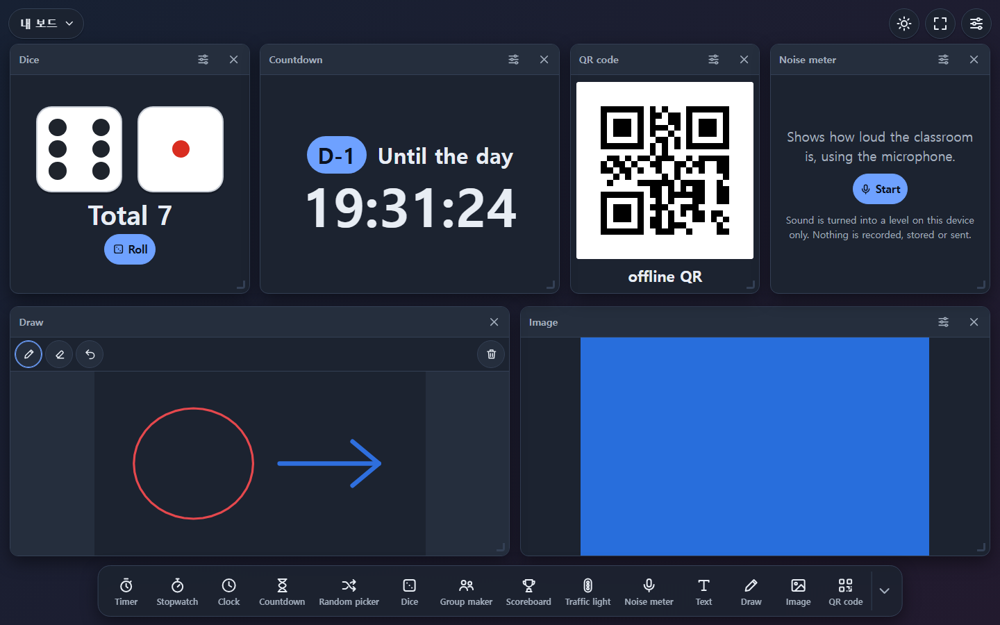
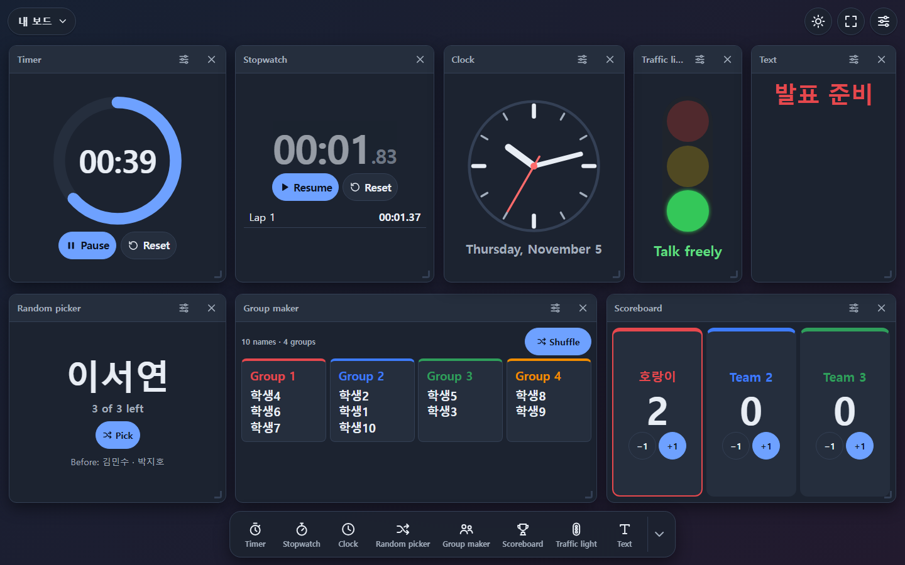
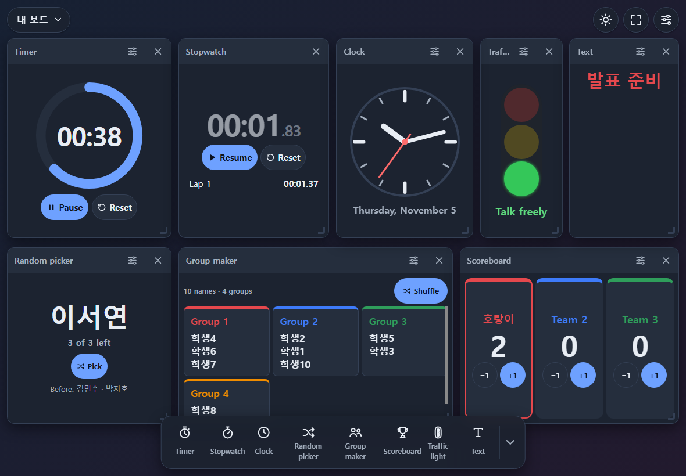
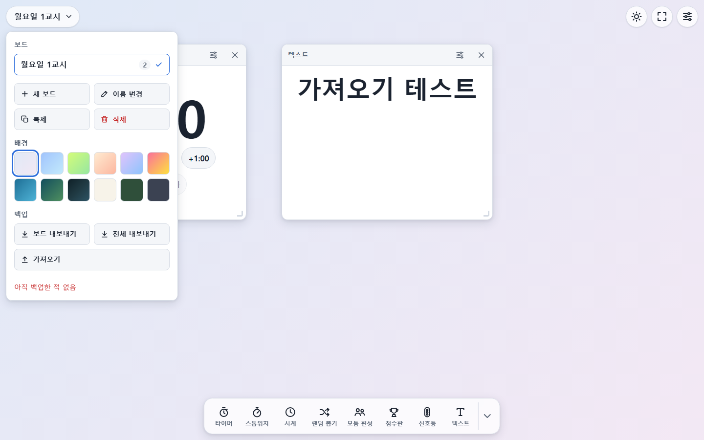

# ClassBoardKit

**English** · [한국어](README.md)

> An offline-first classroom widget board that runs in the browser — no install, no account

**👉 Open it: https://yanniart.github.io/classboardkit/**

ClassBoardKit turns a laptop or tablet screen into a lesson dashboard.
Place any of 15 widgets — timer, random name picker, group maker, scoreboard, activity symbols, QR code and more — wherever you like. Everything is stored only in your own browser.

- **For everyone, no limits**: no account, no payment, no locked features
- **No server**: static hosting on GitHub Pages, nothing is sent anywhere
- **Offline**: works without internet after the first visit, installable as an app
- **No build step**: HTML · CSS · vanilla JavaScript (ES modules); the only runtime dependency is an unmodified QR encoder
- **Languages**: English · Español · 日本語 · 한국어 (translation improvements welcome)
- **Accessible**: everything works with the keyboard, screen-reader announcements, high-contrast theme and Windows contrast themes, automated WCAG 2.1 AA checks



## Status

✅ **v1.0.0** — the backup file format, share links, storage keys and the widget contract are now stable ([ADR-0011](docs/trd/adr/ADR-0011-v1-public-contract.md)). Backups and links you make with v1.0 keep working in every v1.x release.

## Features

| Area | What you get |
|---|---|
| Time | Timer (digits/ring), stopwatch (laps), clock (digital/analog), countdown (D-day) |
| Random & flow | Random name picker (no repeats), dice (1–6), group maker, scoreboard (2–8 teams), traffic light, activity symbols (12), noise meter |
| Display | Text, drawing (pen, eraser, 6 colours), image, QR code |
| Boards | Many boards (rename, duplicate, delete), 12 backgrounds + your own image, drag and resize widgets (mouse, touch, keyboard) |
| Templates | Lesson start, group work, presentations, contests, quiet work/test, break — a ready board in one click |
| Undo | Undo/redo adding, removing, moving and resizing widgets, backgrounds, adding/removing/renaming boards |
| Sharing | Share a board as one link (with a QR code); images and class lists are left out by default |
| Style | Per-board widget look (solid, glass, outline) and 7 accent colours |
| Backup | Export/import the current board or everything as a JSON file (images included), last-backup reminder |
| Screen | Full screen, keep screen awake (Wake Lock), themes (system, light, dark, high contrast) |
| Offline | A service worker caches the whole app and tells you when a new version is ready |

| Dark theme | Tablet | Board menu · backup |
|---|---|---|
|  |  |  |

## How to use

1. Tap a widget in the dock at the bottom to add it. Drag the title bar to move it and the bottom-right corner to resize.
2. Use a widget's ⚙ button to set names, times, teams and so on.
3. Tap the board name at the top left to switch and manage boards, **start from a template**, change the background (the last swatch is your own image), and **back up (export/import) or share a link**.
   The image widget also accepts drag and drop and paste (Ctrl+V).
4. Made a mistake? Use ↶ next to the board name (or Ctrl/⌘+Z). The notice that appears after removing a widget also has "Undo".
5. Whoever opens a **share link** can press "Add board" to get the same board as a new one (their own boards are not changed).
6. Top right: keep screen awake ☀ · full screen ⛶ · settings (language, theme)
7. On a tablet, "Add to Home Screen" installs it like a full-screen app and keeps your data safer.

Keyboard: select a widget, then arrows (move), Alt+arrows (resize), Delete (remove) · Ctrl/⌘+Z (undo), Ctrl+Y · Ctrl/⌘+Shift+Z (redo) · `?` (shortcuts). The first Tab offers "Skip to the widget dock".

## Accessibility

- Add, move, resize, configure, remove and undo widgets with the keyboard alone (only drawing strokes need a pointer).
- Screen readers hear each widget's name and how to operate it, the new position when moving with the keyboard, and the result of a pick, roll, score change or grouping — once. Clock and timer digits are not read every second.
- Text contrast is 4.5:1 or more in the light, dark and high-contrast themes (tested automatically). Windows contrast themes, reduced motion and 200% zoom are supported.
- During development 40 screen states are checked with axe-core in every language ([ADR-0010](docs/trd/adr/ADR-0010-dev-accessibility-testing.md)). Manual screen-reader checks are listed in the [QA checklist](docs/trd/qa-checklist.md) (Korean). Please report anything that gets in your way as an issue.

## Privacy

- Boards, class lists and everything else are stored **only in the browser you use (localStorage; images in IndexedDB)** and never sent to a server.
- The **noise meter** turns the microphone on only when you press "Start" and turns sound into a level number on the device. Nothing is recorded, stored or sent, and the microphone is released when the widget is removed or you switch tabs.
- Before clearing browser data or moving to another device, save a file with **board menu → Backup → Export all**.
- Exported files contain class lists (student names) and the images on your boards — take care when sharing them.
- A **share link** carries the board compressed after the `#` in the address. That part is never sent to a server, but **anyone who has the link can see the board**. Images are never included and class lists are left out by default.

## Contributing

Bug reports, translation improvements and new widgets are welcome — see [CONTRIBUTING.md](CONTRIBUTING.md).

- New widget: `node tools/new-widget.mjs my-widget` creates a working widget to start from → [guide](docs/guides/new-widget.md)
- New language or better wording → [translation guide](docs/guides/translation.md)
- Security issues: please report privately → [SECURITY.md](SECURITY.md)

## Run locally

ES modules and service workers do not work from `file://`, so use a static server:

```bash
python -m http.server 8765 --bind 127.0.0.1
```

> While developing, the service worker may serve older files from its cache. Run `node tools/sw-stamp.mjs` after changing files to get the "new version" notice, or turn on DevTools → Application → Service Workers → "Update on reload".

## Tests

Node.js 20 or newer. Nothing to install.

```bash
node --test                      # unit tests
node tools/i18n-check.mjs        # translation check (keys, placeholders, plurals)
node tools/sw-stamp.mjs          # after changing app files (offline cache list and build hash; tests fail if you forget)
node tools/e2e/m1.mjs            # browser E2E (server running, Edge/Chrome) — m1…m7
```

## Documentation

Design documents (PRD, TRD, ADRs, devlog) are written in Korean; contributor-facing documents are in English and Korean.

| Document | |
|---|---|
| [Release notes](docs/releases/) | What changed in each version |
| [CHANGELOG](CHANGELOG.md) | User-facing changes (Korean) |
| [Data schema](docs/trd/data-schema.md) | Board, widget and export JSON (Korean) |
| [ADR-0011 v1 contract](docs/trd/adr/ADR-0011-v1-public-contract.md) | What stays compatible in v1.x (Korean) |

## License

[MIT](LICENSE)

### Third party

| File | Source | License |
|---|---|---|
| `src/vendor/qrcodegen.js` | [Project Nayuki QR Code generator library](https://www.nayuki.io/page/qr-code-generator-library) v1.4.0, unmodified | MIT, Copyright (c) Project Nayuki |
