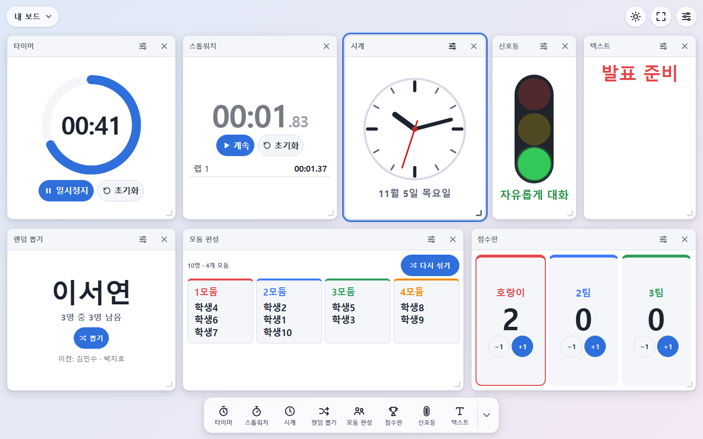
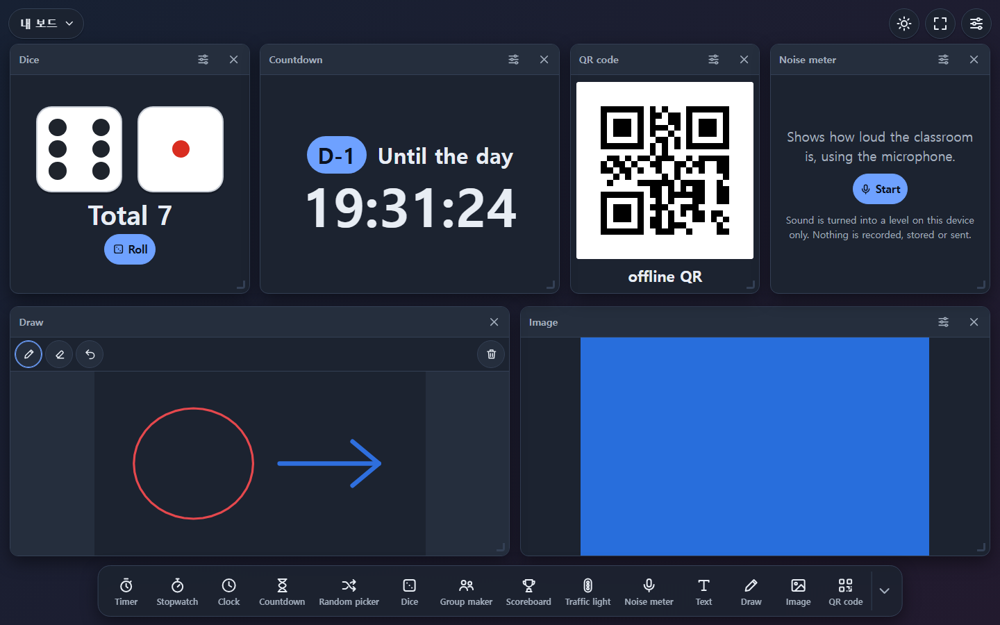
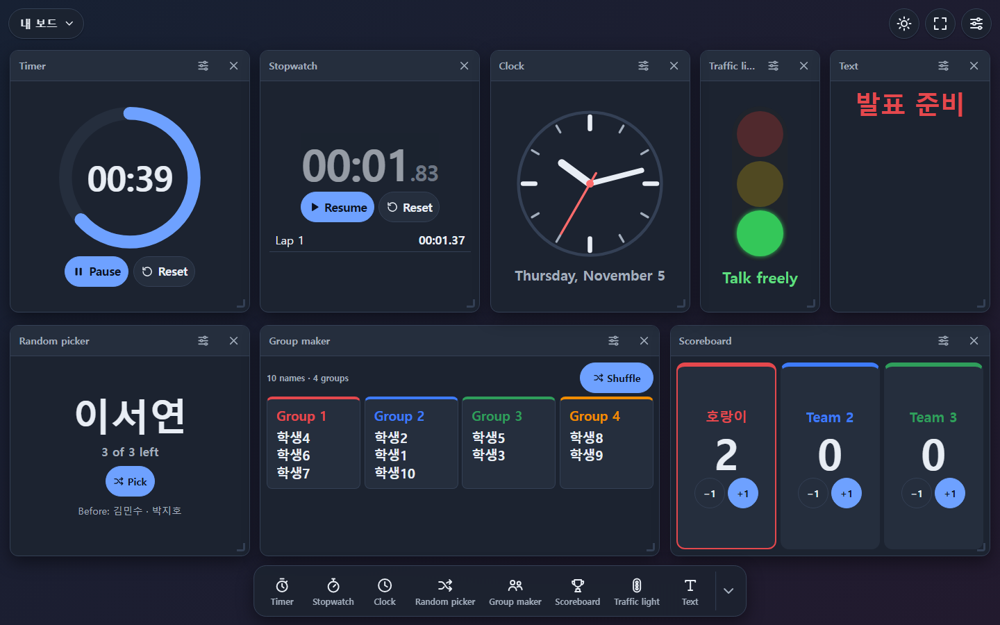
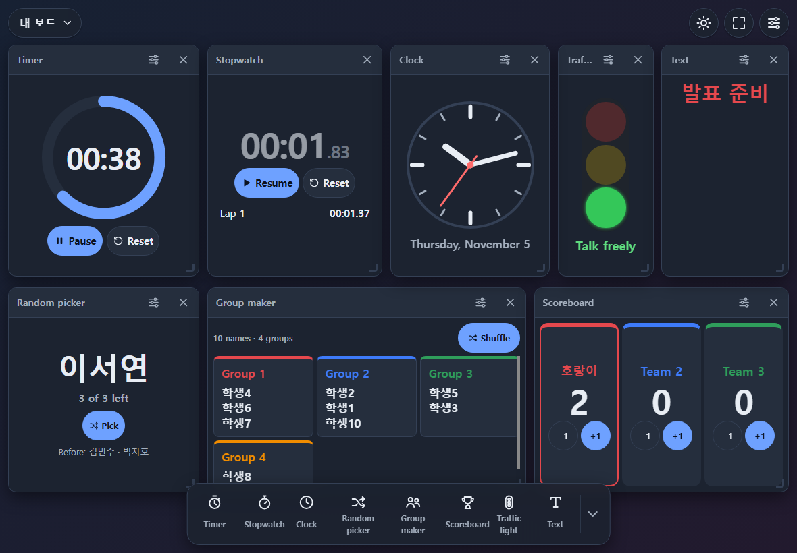
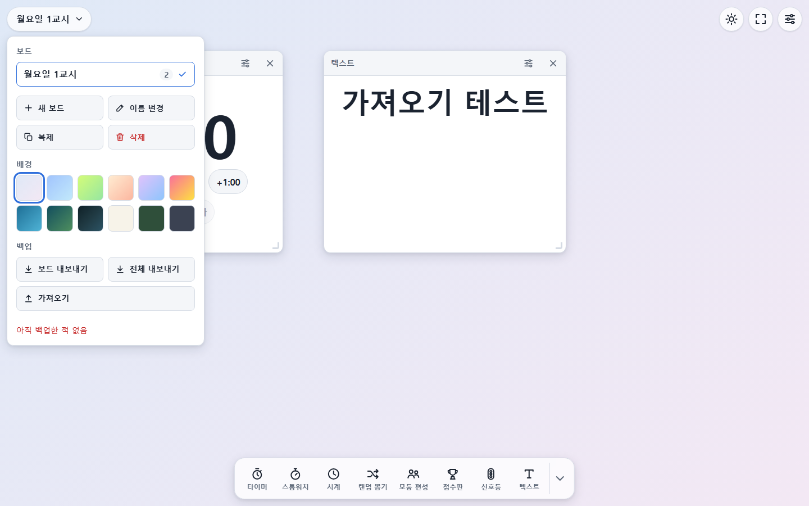
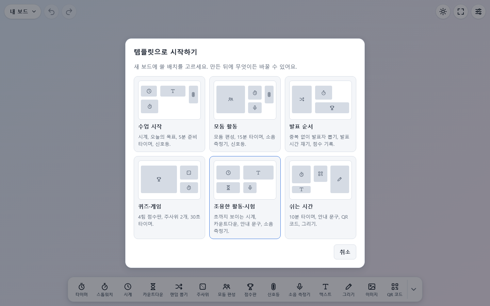
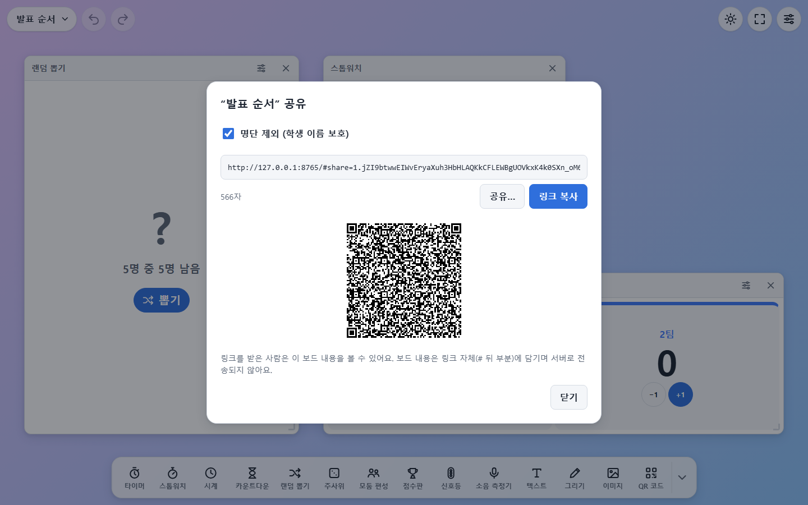
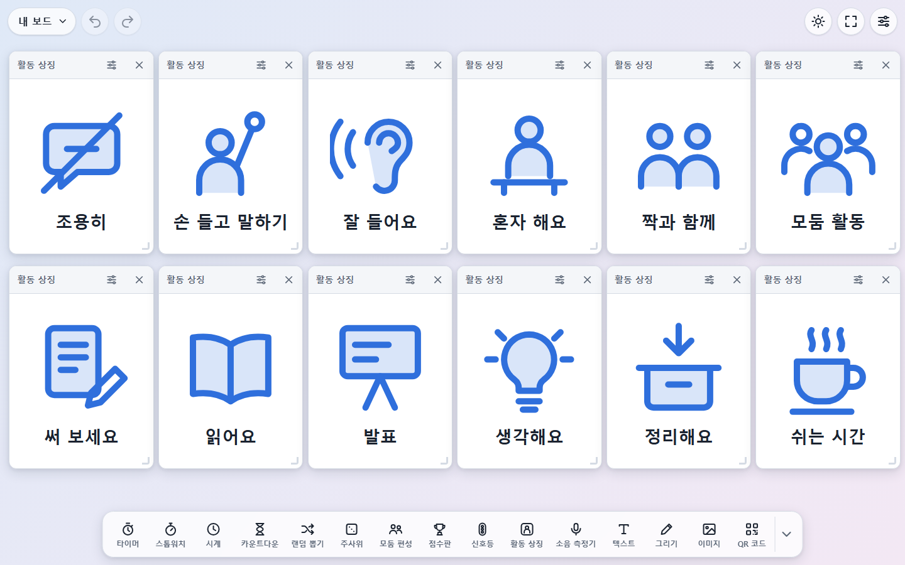
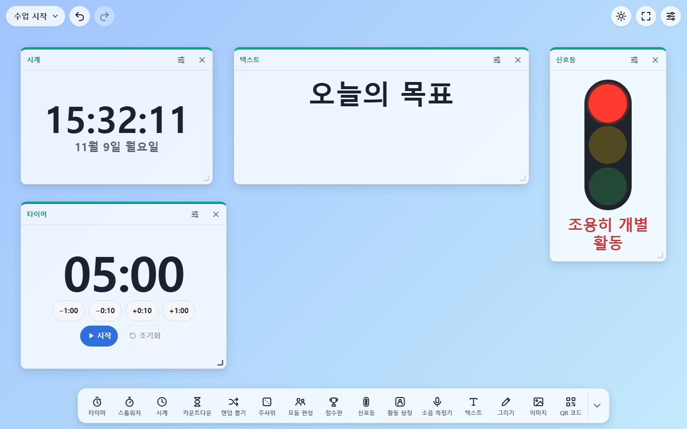

# ClassBoardKit

> 설치·로그인 없이 브라우저에서 바로 쓰는 오프라인 우선 교실 위젯 보드

**👉 바로 사용하기: https://yanniart.github.io/classboardkit/**

ClassBoardKit은 노트북·태블릿 화면을 수업용 대시보드로 바꿔 주는 웹 서비스입니다.
타이머, 랜덤 뽑기, 모둠 편성, 점수판, 활동 상징, QR 코드 같은 위젯 15종을 자유롭게 배치하고, 모든 데이터는 사용자의 브라우저에만 저장됩니다.

- **누구나, 제한 없이**: 계정·결제·기능 제한 없음
- **서버 없음**: GitHub Pages 정적 호스팅, 데이터 외부 전송 없음
- **오프라인**: 한 번 열면 인터넷 없이도 동작, 홈 화면에 앱으로 설치 가능
- **빌드 없음**: HTML · CSS · Vanilla JavaScript(ES Modules), 런타임 의존성은 원본 그대로 넣은 QR 인코더 1개뿐
- **다국어**: 한국어 · 영어
- **접근성**: 키보드만으로 모든 기능, 화면 낭독기 알림, 고대비·Windows 고대비 모드, WCAG 2.1 AA 기준 자동 점검



## 현재 상태

✅ **v0.4.0 공개** (2026-11-09) — M0~M6 완료: 위젯 15종(활동 상징 포함), 템플릿 6종, 실행 취소, 공유 링크, 위젯 모양, 접근성 점검(키보드·낭독기·고대비), 오프라인 PWA

## 기능

| 구분 | 내용 |
|---|---|
| 시간 | 타이머(숫자/원형), 스톱워치(랩), 시계(디지털/아날로그), 카운트다운(D-day) |
| 무작위·진행 | 랜덤 뽑기(중복 제외), 주사위(1~6개), 모둠 편성, 점수판(2~8팀), 신호등, 활동 상징(12종), 소음 측정기 |
| 표시 | 텍스트, 그리기(펜·지우개·6색), 이미지, QR 코드 |
| 보드 | 여러 보드 만들기·이름 변경·복제·삭제, 배경 12종 + 내 이미지, 위젯 드래그·크기 조절(마우스·터치·키보드) |
| 템플릿 | 수업 시작·모둠 활동·발표 순서·퀴즈·게임·조용한 활동·시험·쉬는 시간 — 한 번에 보드 구성 |
| 실행 취소 | 위젯 추가·삭제·이동·크기, 배경, 보드 추가·삭제·이름 변경을 되돌리기·다시 실행 |
| 공유 | 보드를 링크 하나로 공유(QR 코드 포함), 이미지 제외·학생 명단 제외 기본 |
| 꾸미기 | 보드마다 위젯 모양(기본·반투명·테두리)과 강조색 7가지 |
| 백업 | 현재 보드 또는 전체를 JSON 파일로 내보내기·가져오기(이미지 포함), 마지막 백업 시점 표시 |
| 화면 | 전체 화면, 화면 켜두기(Wake Lock), 테마(시스템·라이트·다크·고대비) |
| 오프라인 | Service Worker로 앱 파일 전체 캐시, 새 버전 알림 |



| 다크 테마 (영어) | 태블릿 가로 | 보드 메뉴 · 백업 |
|---|---|---|
|  |  |  |

| 템플릿으로 시작하기 | 공유 링크 |
|---|---|
|  |  |

| 활동 상징 12종 | 위젯 모양 (반투명 · 청록) |
|---|---|
|  |  |

## 사용법

1. 아래 독에서 위젯을 누르면 보드에 추가됩니다. 제목 막대를 끌어 옮기고, 오른쪽 아래 모서리로 크기를 바꿉니다.
2. 위젯의 ⚙ 버튼에서 명단·시간·팀 등을 설정합니다.
3. 왼쪽 위 보드 이름을 누르면 보드 전환·관리, **템플릿에서 새 보드**, 배경(맨 끝 견본 = 내 이미지), **백업(내보내기/가져오기)·공유 링크** 메뉴가 열립니다.
   이미지 위젯에는 파일 선택 외에 끌어 놓기·붙여넣기(Ctrl+V)도 됩니다.
4. 실수했다면 보드 이름 옆 ↶ 버튼(또는 Ctrl/⌘+Z)으로 되돌립니다. 위젯을 지우면 뜨는 알림의 "실행 취소"도 됩니다.
5. **공유 링크**를 받은 사람은 링크를 열고 "보드 추가"를 누르면 같은 보드가 새 보드로 추가됩니다 (기존 보드는 바뀌지 않음).
6. 오른쪽 위 버튼: 화면 켜두기 ☀ · 전체 화면 ⛶ · 설정(언어·테마)
7. 태블릿에서는 브라우저의 "홈 화면에 추가"로 설치하면 전체 화면 앱처럼 쓸 수 있고, 데이터도 더 안전하게 보관됩니다.

키보드: 위젯 선택 후 화살표(이동), Alt+화살표(크기), Delete(삭제) · Ctrl/⌘+Z(실행 취소), Ctrl+Y · Ctrl/⌘+Shift+Z(다시 실행) · `?`(단축키 도움말). 첫 Tab의 "위젯 독으로 건너뛰기"로 바로 위젯을 추가할 수 있습니다.

## 접근성

- 마우스 없이 키보드만으로 위젯 추가·이동·크기 조절·설정·삭제·실행 취소가 됩니다 (그리기의 획만 포인터 전용).
- 화면 낭독기: 위젯 이름과 조작 방법을 읽어 주고, 키보드로 옮기면 위치를, 뽑기·주사위·점수·모둠 결과는 한 번씩 읽어 줍니다. 시계·타이머의 숫자는 매초 읽지 않습니다.
- 라이트·다크·고대비 테마 모두 글자 대비 4.5:1 이상(자동 테스트), Windows 고대비 모드·동작 줄이기·200% 확대를 지원합니다.
- 개발 중에는 40개 화면 상태를 axe-core로 자동 점검합니다 ([ADR-0010](docs/trd/adr/ADR-0010-dev-accessibility-testing.md)). 실제 스크린리더 확인은 [QA 체크리스트 11절](docs/trd/qa-checklist.md)에 있습니다. 불편한 점은 Issue로 알려 주세요.

## 개인정보

- 보드·명단 등 모든 데이터는 **사용 중인 브라우저(localStorage, 이미지는 IndexedDB)에만** 저장되며 어떤 서버로도 전송되지 않습니다.
- **소음 측정기**는 "측정 시작"을 눌렀을 때만 마이크를 켜고, 소리를 기기 안에서 크기 숫자로만 바꿉니다. 녹음·저장·전송하지 않으며, 위젯을 지우거나 다른 탭으로 가면 마이크를 끕니다.
- 브라우저 데이터를 지우거나 다른 기기로 옮길 때는 **보드 메뉴 → 백업 → 전체 내보내기**로 파일을 저장해 두세요.
- 내보낸 파일에는 랜덤 뽑기·모둠 편성 명단(학생 이름 등)과 보드에 쓴 이미지가 들어 있으니 공유할 때 주의하세요.
- **공유 링크**는 보드 내용을 주소의 `#` 뒤에 압축해 담습니다. 이 부분은 서버로 전송되지 않지만, **링크를 받은 사람은 누구나 보드 내용을 볼 수 있습니다.** 이미지는 넣지 않고, 학생 명단은 기본으로 빼고 만듭니다.

## 문서

| 문서 | 설명 |
|---|---|
| [문서 인덱스](docs/README.md) | 문서 작성 규칙과 전체 목록 |
| [PRD](docs/prd/PRD.md) | 제품 요구사항 |
| [TRD](docs/trd/TRD.md) | 기술 요구사항 |
| [데이터 스키마](docs/trd/data-schema.md) | 보드·위젯·내보내기 JSON 구조 |
| [로드맵](docs/roadmap/ROADMAP.md) | 단계별 마일스톤 |
| [릴리스 노트](docs/releases/) | [v0.4.0](docs/releases/v0.4.0.md) · [v0.3.0](docs/releases/v0.3.0.md) · [v0.2.0](docs/releases/v0.2.0.md) · [v0.1.0](docs/releases/v0.1.0.md) |
| [개발 로그](docs/devlog/) | 날짜별 작업 기록 |
| [벤치마킹](docs/research/benchmark-classroomscreen.md) | 참고 서비스 분석 |

## 로컬 실행

ES Modules·Service Worker는 `file://`에서 동작하지 않으므로 정적 서버가 필요합니다.

```bash
python -m http.server 8765 --bind 127.0.0.1
```

> 개발 중에는 Service Worker가 이전 파일을 캐시에서 내줄 수 있습니다. 파일을 바꾼 뒤 `node tools/sw-stamp.mjs`를 실행하면 화면에 "새 버전" 알림이 뜨고, DevTools → Application → Service Workers → "Update on reload"를 켜 두면 편합니다.

## 테스트

Node.js 20 이상이 필요합니다. 설치할 패키지는 없습니다.

```bash
node --test                      # 단위 테스트
node tools/sw-stamp.mjs          # 앱 파일을 바꾼 뒤 (오프라인 캐시 목록·버전 갱신, 잊으면 테스트 실패)
node tools/e2e/m1.mjs            # 브라우저 E2E (서버 실행 후, Edge/Chrome 필요) — m1~m6 (m6은 접근성 점검: 개발 전용 axe-core를 `.tools/axe/`에 받아 두면 함께 실행)
```

## 라이선스

[MIT](LICENSE) — [ADR-0005](docs/trd/adr/ADR-0005-license.md)

### 서드파티

| 파일 | 출처 | 라이선스 |
|---|---|---|
| `src/vendor/qrcodegen.js` | [Project Nayuki QR Code generator library](https://www.nayuki.io/page/qr-code-generator-library) v1.4.0, 원본 그대로 ([ADR-0006](docs/trd/adr/ADR-0006-qr-library-vendoring.md)) | MIT, Copyright (c) Project Nayuki |
